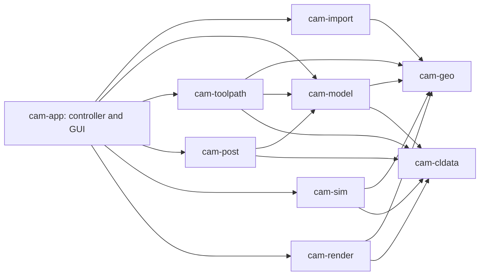

# Architecture assessment: OpenCAMStudio

Assessment date: **2026-10-13**. Repository: [pr0m1th3as/OpenCAMStudio](https://github.com/pr0m1th3as/OpenCAMStudio). Audited revision: [`5c510b504fe39f4e40700ff3b1e331d0309fcad3`](https://github.com/pr0m1th3as/OpenCAMStudio/tree/5c510b504fe39f4e40700ff3b1e331d0309fcad3), `main` as retrieved for this review; commit dated 2026-08-05. This is a source-based assessment of that revision, not a certification of machine safety or a benchmark against a commercial product.

Companion documents: [implementation plan](implementation-plan.md) and [validation evidence and reproduction](architecture-validation.md).

## 1. Verdict

**The architecture is modular at the crate level and provides a good foundation for extending 2.5D milling. It is not yet a complete architectural foundation for an industrial CAM system.** Keep the existing pipeline and planar geometry; evolve the domain contracts before implementing full-machine simulation or multi-axis machining.

The strongest decisions are the controller-neutral cutter-location IR, headless strategy and simulation libraries, separation of machine limits from controller formatting, deterministic planar geometry, and explicit document migrations. These are substantial reusable assets.

The principal limitations are structural: tools are identified by controller numbers; a document has one setup with translation-only origins; machine definitions contain limits rather than kinematics; simulation sees cutter bottoms and heightfield stock rather than assemblies and a machine scene; and the GUI computes jobs synchronously. Those constraints cannot all be resolved by adding another strategy or post.

**Industrial capability is achievable through staged architectural evolution, not a wholesale rewrite.** A credible first product scope is qualified fixed-axis, three-axis milling on explicitly supported machine/controller configurations. Simultaneous 4/5-axis, turning and mill-turn require additional motion, kinematic and process models and separate qualification programs. The existing roadmap's EdgeCAM-class ambition should remain a long-term direction, not a statement of current readiness.

### Direct answers to the requested features

| Feature | Implemented now | Readiness / changes needed |
|---|---|---|
| Tool library | Persistent cross-project library, rich built-in cutter geometry, family filtering, import/export, numbering and reconciliation; projects embed used tools | Good foundation. Add stable IDs, revisions, holder assemblies, gauge lengths and machine-specific assignments |
| ATC | Neutral `ToolChange`, numbered tool selection and post output; planner inserts transition lifts; Carve can change tools internally | Partial. No magazine/pocket model, change-policy contract, preselection, assembly binding or ATC envelope. `Tn M6` alone is insufficient |
| Programmable posts | Seven compiled posts across four output families; shared dialect walker plus separate Okuma emitter; capabilities and golden tests | Good formatting seam, but no user-defined post packages or runtime. Add versioned machine/controller profiles, typed event hooks, constrained scripting and validation |
| Full CNC/fixture simulation | Heightfield removal and backplot; travel-envelope visualization | Major extension. No articulated machine, fixtures, holder meshes, scene graph, controller execution interpreter or simulation timeline |
| Collision detection | Cutter-profile rapid-through-stock checks; separate target-heightfield gouge API | Narrow existing support. No cutter/holder/shank/fixture/machine collision pipeline; incomplete cycle traversal; gouge API not integrated in application export |
| 3D toolpaths | XYZ linear moves, XY circular/helical moves, variable-depth V-carving and thread milling | Motion representation can support initial fixed-axis surface paths. No general 3D CAD/surface queries or surface strategies. Tool orientations, arbitrary arc planes and rotary-axis motion need IR evolution |

## 2. Review method and confidence

Inspected workspace manifests, all crate responsibilities, principal model/IR APIs, planner and controller execution/export paths, all post families, simulation and rendering interfaces, import mapping, persistence/migrations, representative strategies, tests and CI. There were no `AGENTS.md` files in the checkout. The local workspace initially contained no source files; a separate `OpenCAMStudio/` checkout was downloaded, preserving the workspace's original empty Git repository.

Executed the locked headless workspace tests, followed by a run with `--no-fail-fast` to collect the remaining suites after failures. Independently exercised four public-API counterexamples; details and exact outcomes are in [validation](architecture-validation.md). GUI execution, real-controller acceptance, machine cutting, comparative performance and hardware collision qualification were not performed.

Distinguish three evidence levels throughout this report:

- **Implemented:** visible in source or executed tests.
- **Reproduced finding:** an executable counterexample demonstrated the behavior.
- **Recommendation:** proposed design, not functionality currently shipped.

## 3. Actual architecture

### 3.1 Crate responsibilities and dependencies

There are **nine implemented workspace crates**. The production dependency graph is acyclic; tests add useful cross-crate integration dependencies.

| Crate | Actual responsibility | Production internal dependencies |
|---|---|---|
| `cam-cldata` | `Point3`, motion/control/cycle events, provenance tags, program builder and translations | None; no external dependencies |
| `cam-geo` | Planar contours, polygon booleans/offsets, arc fitting, strokes and tool revolve profiles | None; `i_overlay` and serde |
| `cam-import` | DXF/DWG entities → planar closed regions and open chains | `cam-geo` |
| `cam-model` | Machine scalar limits, cutters, typed operations, setup, history, migrations and tool reconciliation | `cam-geo`, `cam-cldata` |
| `cam-toolpath` | Eight strategies, planar clearing engines, guards, motion emission and job sequencing | `cam-geo`, `cam-cldata`, `cam-model` |
| `cam-post` | Controller capabilities, dialects, modal writer, travel/rate checks | `cam-cldata`, `cam-model` |
| `cam-sim` | Heightfield removal, simplified cutter profiles, rapid-stock checks, surface comparison | `cam-cldata`, `cam-geo` |
| `cam-render` | Backplot scene, camera/gizmo, meshes and optional GPU renderer | `cam-cldata`, `cam-geo` |
| `cam-app` | Headless controller, file/config/libraries, GUI and pipeline integration | All eight other crates |

Evidence: [workspace](../Cargo.toml) and `crates/*/Cargo.toml`.

Arrows denote dependencies, not runtime data flow. At runtime, imported planar geometry feeds operation creation; strategies emit IR; the controller derives display and simulated stock, gates export, translates coordinates per datum and invokes the selected post.

**`cam-kernel` and `cam-plugin-api` do not exist in the audited workspace.** There is no implemented `Kernel` abstraction, STEP/B-rep backend or dynamic plugin loader. They appear in [ARCHITECTURE.md](../ARCHITECTURE.md) as intended architecture. `web/` is a placeholder landing page; [Pages CI](../.github/workflows/pages.yml) does not build the application for WASM.

### 3.2 What is clean and worth preserving

1. **The IR separates machining intent from controller syntax.** Strategies emit `Program`; posts format it and simulation/rendering consume it. Drilling remains a cycle intent, with posts choosing canned or expanded output. This prevents individual strategies from embedding controller words. [IR](../crates/cam-cldata/src/lib.rs), [post interface](../crates/cam-post/src/lib.rs).
2. **The geometry boundary hides its implementation.** Downstream code uses project-owned contour/polygon types rather than `i_overlay` types. A fixed 0.0001 mm grid improves repeatability. This is a good planar CAM kernel boundary, although it does not establish an end-to-end machining error bound. [geometry API](../crates/cam-geo/src/lib.rs).
3. **Headless execution is real.** Default features exclude the desktop GUI; controller, strategies, posts and simulation are testable independently of a window/GPU. `cam-sim` has no rendering dependency. [app manifest](../crates/cam-app/Cargo.toml), [simulation manifest](../crates/cam-sim/Cargo.toml).
4. **Physical limits and controller dialects are separate concepts.** The machine library binds an installation to a post while `cam-model::Machine` remains independent of `cam-post`. A foreign project's machine/post are retained as provenance instead of silently replacing the active local installation. Preserve this safety distinction. [machine library](../crates/cam-app/src/machines.rs), [open_project](../crates/cam-app/src/controller.rs#L745).
5. **Tool suitability has a geometric basis.** Revolve profiles tag cutting and non-cutting surfaces; strategy guards derive many capabilities from these rather than duplicating every cutter class. Explicit process exceptions, such as refusing to side-mill with a drill, are appropriate. [tool profiles](../crates/cam-geo/src/toolprofile.rs), [guards](../crates/cam-toolpath/src/guards.rs).
6. **Persistence has intentional compatibility machinery.** Schema version 13 has explicit migrations; future versions are refused. Config loading preserves unreadable files and backs them up; settings and machine-library unknown fields can round-trip. [migrations](../crates/cam-model/src/migrate.rs), [config](../crates/cam-app/src/config.rs).
7. **There is meaningful correctness testing.** Golden NC fixtures, tool/datum modal checks, geometric checks, controller tests and strategy verification tests exist. CI includes headless and GUI-feature builds/tests and clippy. These are more valuable than UI-only smoke tests. [CI](../.github/workflows/ci.yml), [tool-change tests](../crates/cam-post/tests/toolchange.rs), [simulation tests](../crates/cam-sim/tests/verify.rs).

### 3.3 Where cleanliness and modularity weaken

**The application is the growing integration bottleneck.** `gui.rs` has 10,023 lines and `controller.rs` 4,443, including tests. The controller mixes document editing, import, picking/snapping, geometry selection, tool reconciliation, job planning, simulation mesh conversion and posting. The GUI contains numerous operation-specific controls and rerun triggers. The existing headless controller is useful, but neither a thin view nor a small orchestration layer at this scale. Split responsibilities with behavior-preserving extractions, not arbitrary file slicing.

**Extensibility is closed across several layers.** A new built-in operation touches `Operation`, its repeated accessors, `OpKind`, family filters, planner dispatch, controller construction and GUI inspectors. `Strategy` is a good computation interface, but no registry routes an open set of operations. `PostKind` is similarly closed; `Dialect` is private compiled data. Closed enums are reasonable for current first-party correctness. They are not an implemented plugin ecosystem. [operation model](../crates/cam-model/src/document.rs#L980), [planner dispatch](../crates/cam-toolpath/src/plan.rs#L322), [GUI](../crates/cam-app/src/gui.rs).

**The proposed plugin seam is not a stable binary ABI.** Rust traits, references, `Vec`, `String`, lifetimes and Rust-owned atomic cancellation cross the current interfaces. Plain-looking Rust data is not portable C ABI data, and Rust trait-object layouts are not a versioned compatibility contract. A `cdylib` extraction needs explicit buffer ownership, ABI negotiation, errors and cancellation/progress transport, or a serialized process/WASM boundary. Defer ABI freezing until the domain model settles. [Strategy and JobEnv](../crates/cam-toolpath/src/lib.rs#L177), [Post](../crates/cam-post/src/lib.rs#L405).

**Project persistence lives in the shell.** `cam-model::Document` does not contain the full reusable project; `cam-app::Project` owns imported geometry, defaults and machine/post provenance. Operations embed contour copies rather than reference stable model entities. This works for self-contained drawings, but makes CAD revision association, dependency tracking and large solid assets difficult. Refactor towards a domain project plus a persistence adapter; keep UI selections/settings outside it. [Project](../crates/cam-app/src/project.rs#L155).

**Snapshot history will grow with the domain.** Every document edit clones the prior document into unbounded history. Currently this is simple and reliable. With meshes, B-reps, stock snapshots and thousands of operations, immutable shared assets, bounded history and coalesced edits become necessary. [History](../crates/cam-model/src/history.rs).

**Documentation has drifted from implementation.** Root architecture prose lists unimplemented crates and promises off-thread jobs, while `Gui::rerun` calls `controller.run` synchronously. It says the machine is not saved; schema 11 introduced saved provenance. `Project` field comments still say saved machines are adopted, while `open_project` explicitly does the opposite. Root prose lists six posts; code has seven. Roadmap preferences are described as missing despite implemented settings. Fix the documentation without removing the good future intent. [architecture](../ARCHITECTURE.md), [roadmap](../ROADMAP.md), [rerun](../crates/cam-app/src/gui.rs#L4713), [project comments](../crates/cam-app/src/project.rs#L169).

## 4. Domain readiness for industrial CAM

### 4.1 Tool library and ATC

The cutter library already covers end/ball/bull-nose/face mills, drills, chamfer/V cutters and thread mills, including flute, neck and shank dimensions and nominal cutting data. Geometry-based reconciliation rewrites secondary tool references too. This is a strong existing subsystem, not a feature that needs to start from zero. [Tool](../crates/cam-model/src/lib.rs#L299), [library](../crates/cam-app/src/tool_library.rs), [reconciliation](../crates/cam-model/src/reconcile.rs).

However, `Tool.number: u32` currently combines domain identity with emitted `Tn`; operations and simulation resolve tools by that number. A shop catalog item, a physical assembled tool, a controller tool number, an H/D offset register and a magazine pocket are different identities. Matching geometry cannot distinguish two physically different assemblies of the same cutter geometry, and renumbering should not change operation intent.

Needed model separation:

- Stable cutter definition ID and revision; catalog/material/coating/grade metadata.
- Holder/arbor/extension definition, full cutting/non-cutting envelope and interface.
- Assembly ID, actual stickout/gauge length and cutter/holder transforms.
- Installation assignment: assembly → controller T number, H/D registers, magazine pocket and measured offsets.
- Machine-specific manual/automatic change policy, preselection support, permitted change pose and postconditions.

ATC implementation also needs sequence semantics. The planner inserts same-datum lifts, but does not explicitly stop spindle/coolant before every change or force their restart if a control's M6 stops them. Carve inserts a tool change inside its strategy fragment, at its own clearance, without routing through a shared complete transition policy. This is controller-dependent risk, not proof that every machine will collide. The target should be centralized tool-use scheduling that expands changes against an installation policy, including changes inside compound operations. [planner](../crates/cam-toolpath/src/plan.rs#L184), [Carve change](../crates/cam-toolpath/src/carve.rs#L713).

The post writer also deliberately retains its tracked XYZ position across M6, and a test requires suppression of unchanged Z afterward. An unchanged coordinate frame does not prove an unchanged physical pose: a tool-change macro can move axes and leave them at its change position. Require a profile-defined return-pose guarantee or invalidate tracked position and explicitly restore a verified approach, including Z. This is a source-level policy gap, not an executed machine failure. [modal tests](../crates/cam-post/tests/toolchange.rs#L146).

Current `tool_change_pos` is a scalar point; it is not sufficient for carousel/swing-arm clearance or a verified approach. CAM should model relevant machine motions and assumptions, while controller/PLC logic remains responsible for the physical ATC handshake.

### 4.2 Programmable G-code / posts

Seven `PostKind` variants exist: Grbl, FluidNC, grblHAL, LinuxCNC, Fanuc, Haas and Okuma. Shared family formatting is efficient; Okuma's separate emitter is a sensible response to divergent semantics. Compiled posts offer a useful seam, but editing controller behavior currently requires a Rust source change and rebuild. [post selection](../crates/cam-post/src/lib.rs#L41), [dialect](../crates/cam-post/src/dialect.rs), [Okuma](../crates/cam-post/src/okuma.rs).

Capabilities are six booleans. Industrial profiles need richer parameters: arc planes, IJK mode, radius/chord limitations, cycle variants, length/radius compensation, unit/feed modes, probing/macros, rotary/TCP behavior, safe-start/reset states and firmware/options. Capability declarations should drive validation and lowering, not merely describe a family.

**Concrete compatibility issues:** Grbl declares tool changes supported and the shared emitter outputs `Tn M6`. Stock Grbl's official supported M-code list excludes M6; treating Grbl, FluidNC and grblHAL as byte-identical loses installation-specific behavior. Reject multi-tool export or use an explicitly configured sender/manual-change workflow for stock Grbl. This should be a controller-specific policy, not silent stripping. [current Grbl capabilities](../crates/cam-post/src/grbl.rs#L25), [official Grbl command reference](https://github.com/gnea/grbl/blob/master/doc/markdown/commands.md?plain=1). grblHAL documents M6 behavior as configuration-dependent, reinforcing the need for installation profiles. [official grblHAL reference](https://github.com/grblHAL/grblhal_docs/blob/main/content/markdown/04-Reference/02-complete-gcode-and-mcode-reference.md).

The shared LinuxCNC/Fanuc/Haas preambles cancel tool length compensation (`G49`), but their tool-change branch does not emit explicit length-offset activation. Okuma does emit its `G56 H<tool>`. M6 and compensation activation are distinct on LinuxCNC. A macro may activate compensation, but that assumption is not encoded in the current model. Require a tested profile specifying who activates and cancels offsets. [current emitter](../crates/cam-post/src/dialect.rs#L173), [official LinuxCNC tool compensation](https://linuxcnc.org/docs/html/gcode/tool-compensation.html).

Programmable posts should provide versioned metadata, declared capabilities, typed lifecycle/motion events, a central modal writer, machine-specific configuration and controlled scripts. Use generated text source maps and an independent supported-subset NC interpreter to verify output. Unsupported macros or ATC internals must produce explicit verification coverage limits; scripts must not silently convert an unverified job into a verified artifact.

### 4.3 Setups, fixtures and coordinate frames

`Document` contains one `Setup`; stock is an axis-aligned bounding block. Additional origins are positions and numeric selectors, not rigid transforms. The planner groups by origin and inserts an operator stop for a change, assuming a re-fixture. This does not model a rotated part, independent fixture placements or multiple stationary work offsets in one setup. [setup/origin/document](../crates/cam-model/src/document.rs#L1169), [grouping](../crates/cam-toolpath/src/plan.rs#L116).

Introduce multiple explicit setups with rigid transforms, fixture instances, stock state, target geometry and an explicit transition kind. A datum selection and a physical part reorientation must be separate actions. Store resolved machine placement when available; when unavailable, travel fitting remains only a size precheck. Unknown datum references should fail validation rather than fall back to the base origin during machining.

Fixtures need material/collision geometry, body IDs, transforms, clamp states and revision tracking. Re-fixturing needs either stock transformation/carry-forward or an explicit new-stock model, not a continuous single heightfield that ignores all `Datum` events.

### 4.4 Full simulation and collision detection

The implemented simulator is useful for fixed-axis planar work. It removes material using a bottom profile and catches selected rapids through stock. But `SimTool` has only a number and `ToolProfile { radius, shape }`; cutter flute length, neck, shank and holder are not part of runtime collision geometry. Geometry-based strategy suitability guards do not substitute for swept holder/fixture verification. [simulation API](../crates/cam-sim/src/lib.rs#L155).

The heightfield stores one top height per XY cell. It cannot represent overhangs, undercuts, arbitrary reorientation, separate material intervals or multi-axis removal. `simulate` initializes using stock top and XY extent; bottom Z is used later by display meshing rather than enforcing a material interval. Arc removal uses a hardcoded 0.1 mm flatten tolerance. Rapid checks use the lower endpoint Z across a lateral segment, which is conservative but can over-report diagonal moves. Resolution is selected mainly for preview quality and bounded by a cell budget; it is not a certified detection threshold. [heightfield](../crates/cam-sim/src/heightfield.rs), [arc flattening](../crates/cam-sim/src/lib.rs#L326), [application resolution](../crates/cam-app/src/controller.rs#L2141).

Known verification gaps:

- `Drill` removes material at hole endpoints and resets current position to `None`; it does not execute approach/retract/peck motions. A subsequent rapid can escape checking. **Reproduced.**
- Unknown tool numbers silently select a default flat cutter. A verification run should reject unresolved geometry.
- The first motion has no initial machine pose to check. Tool-change and datum events do not simulate machine motion or fixture changes.
- Controller cutter-compensation events are ignored by the simulator. Nominal programmed geometry and the physical compensated cutter-center trajectory can differ; verification must resolve the active offset policy or report that motion as unsupported.
- `check_gouge` exists for a separately supplied target heightfield; the application does not supply that target or call the function. Export currently blocks rapid-stock collisions, not general target gouges.
- No collision categories for holder/stock, cutter/fixture, spindle/fixture, machine/self-collision or joint limits exist.
- Reports contain a point/message but no source segment, collision bodies, time interval, closest distance or uncertainty bound.

These are architectural limits of the current verifier, not a judgment that heightfields are inherently unsuitable for all industrial three-axis work. Keep a fast heightfield backend for supported fixed-axis stock and add a volume-capable backend where the domain requires one.

Full-machine verification needs a transform/joint tree, axis limits and reference frames, cutter/holder/fixture/machine geometry, broad-phase acceleration and conservative swept narrow-phase checks. Collision policy must distinguish intended cutter-stock contact from forbidden non-cutting-body contact. A rendered machine mesh alone is not a verifier.

### 4.5 Three-dimensional and multi-axis toolpaths

The IR already represents XYZ line segments, so an initial mesh-based fixed-axis finishing strategy can reuse posts and much of the renderer. Existing V-carving and helices demonstrate varying Z, but they do not constitute machining arbitrary surfaces. `cam-geo` remains planar; CAD import maps supported entities to XY and drops Z, with no unit-normalization logic visible in this adapter. There is no STEP/STL/solid asset model or surface-selection API. [CAD mapping](../crates/cam-import/src/lib.rs#L154), [IR steps](../crates/cam-cldata/src/lib.rs).

Fixed-axis surface machining needs triangle/B-rep queries, normals and spatial acceleration, cutter contact calculations, machining/avoidance boundaries, tolerances, roughing/rest stock and clearance linking. A ball-nose cutter-center raster is a manageable first vertical slice; production finishing also needs waterline/constant-scallop/steep-and-shallow strategies and reliable trimming.

For 3+2 and simultaneous multi-axis, extend the model beyond `Point3`: tool pose/orientation, machine joint positions, feed/time semantics, kinematic solutions, rotary wrap/unwind and TCP modes. `Step::Arc` currently has no plane and is consumed as XY + helical Z. Define plane-aware curves or explicitly linearize according to a global tolerance; merely adding A/B/C words is not enough.

Kernel choice should be capability-driven. A triangle backend can deliver the first surface slice; a CAD adapter can later provide STEP/B-rep faces. Evaluate candidate backends on actual import, trimming, normals, bounds, tolerance and failure behavior. OCCT's tessellation facilities are documented, but that does not establish suitability or integration cost without a prototype. [official OCCT meshing guide](https://github.com/Open-Cascade-SAS/OCCT/blob/master/dox/user_guides/mesh/mesh.md). Do not let kernel-owned types leak into operation/strategy contracts.

## 5. Prioritized findings

Priorities below are roadmap priorities: **P0 = prerequisite for trustworthy export**, **P1 = prerequisite for industrial three-axis product scope**, **P2 = scale/extensibility work**. They are not a claim of a formal safety classification. Source links refer to this checkout; pinned repository links in validation establish the audit revision.

| ID | Priority | Finding and impact | Evidence / suggested action |
|---|---|---|---|
| A01 | P0 | Cancelled computation can export an incomplete/empty job. `build_job` loses `StrategyResult.cancelled`; `RunOutcome` has no completion state | Reproduced pre-cancelled job exports. Preserve completion state; reject cancelled/incomplete jobs at every export API |
| A02 | P0 | Travel bounds include arc endpoints only; an arc can exceed travel while passing the check | Reproduced 40 mm full circle accepted on 10 mm travel. Analytically bound swept arc extrema, then separately check resolved machine axes |
| A03 | P0 | Simulator does not traverse drill cycle motions and clears position afterward | Reproduced lateral rapid into uncut stock yields zero collisions. Use shared canonical execution expansion, including cycles and inter-cycle links |
| A04 | P0 | Post writer checks only upper feed/spindle limits; no central finite/positive coordinate/rate validation | Reproduced NaN coordinate with negative feed accepted. Validate complete IR and machine/options before lowering and after formatting |
| A05 | P0 | Grbl declares/emits unsupported M6; shared posts omit explicit length compensation policy | Correct capabilities by installation; validate manual/ATC and H/D policies with accepted controller programs |
| A06 | P0 | Tool-change state and clearance are distributed across planner, strategy and post; writer retains position without an encoded return-pose guarantee | Centralize transition policy; explicitly model spindle/coolant/offset/pose postconditions; preserve internal multi-tool ordering |
| A07 | P0 | Existing headless tests are not all green on this environment | Four clearing unit-test failures reproduced. Establish cause and supported-toolchain baseline before further feature work |
| A08 | P1 | Verification coverage is narrower than an operator may infer from a clean run | Missing fixtures/holders/machine bodies and application target gouge checks; report coverage and block unsupported verification claims |
| A09 | P1 | Single setup with translation-only origins conflates WCS selection and re-fixturing | Introduce explicit setups, rigid transforms, fixture instances and transition semantics |
| A10 | P1 | Number-based tool identity cannot reliably model assemblies/ATC assignments | Separate stable tool/assembly identities from T/H/D/pocket mappings and immutable revisions |
| A11 | P1 | Jobs run synchronously in GUI; cancellation/progress absent at application job level | Background immutable requests; request/revision IDs; cooperative cancellation across strategies, simulation and rendering preparation |
| A12 | P1 | No 3D geometry asset/query contract or fixed-axis surface strategies | Add mesh asset/query boundary, then surface paths; introduce CAD adapter after a capability spike |
| A13 | P1 | Project/config writes overwrite directly; computation exclusions are session-only | Atomic writes with visible errors/recovery. Decide and persist manufacturing suppression separately from transient view state |
| A14 | P2 | Monolithic application/controller and closed operation/post dispatch expand change surface | Extract services and shared metadata; keep typed built-ins; add extension registry only after domain stabilization |
| A15 | P2 | Snapshot history, complete-program clones and repeated geometry copies may become expensive | Benchmark first; immutable assets, bounded/coalesced history, per-operation artifacts and dependency-aware invalidation |
| A16 | P2 | Documentation describes planned boundaries as existing capabilities | Update architecture inventory/status, machine provenance rules, async claims, post count and roadmap |

Travel-span checking is still useful as an early necessary condition. It cannot verify absolute placement, rotary limits or actual machine clearance until setup-to-machine transforms and joint states are known. Keeping that distinction explicit is essential.

## 6. Other necessary product capabilities

Beyond the requested features, the following are needed for a credible qualified milling product:

- **Machining tolerance contract:** one error budget for CAD tessellation, offsetting, path fitting, post rounding and verification; distinguish visual LOD from checking resolution.
- **Associative projects:** stable geometry/operation IDs, CAD revision detection, dependency graph, regeneration and explicit broken-reference handling.
- **Stock-aware planning:** in-process stock across operations and setups, rest roughing, local collision-safe links and configurable allowances.
- **Materials and feeds/speeds:** cutting data by cutter/material/engagement, spindle torque/power limits, warnings with justified operator overrides and provenance.
- **Complete drilling workflows:** spot, drill, peck, countersink, bore, ream and rigid tapping where the controller supports them; typed cycle semantics and clear hole-depth conventions.
- **Setup and shop documentation:** tool sheets, assemblies/offsets/pockets, WCS/clamp diagrams, stock dimensions, revision, post/machine fingerprints and verification coverage.
- **Export assurance:** independent NC re-interpretation for the supported subset; source mapping; stale verification invalidation; clear unsupported/unknown outcomes.
- **Operational reliability:** autosave/recovery, atomic persistence, resource budgets, cancellation, progress, actionable diagnostics and reproducible issue bundles.
- **Release qualification:** versioned machine/post packages, controller fixtures, cross-platform CI, geometry regressions/fuzzing, performance datasets and auditable regression gates.
- **Longer-term processes:** probing, indexed machining, simultaneous axes, turning and mill-turn as separate capability families rather than forced into milling assumptions.

Direct machine streaming/DNC is optional for a CAM product that exports qualified NC. It should not be a prerequisite to solving the core geometry, simulation and post problems.

## 7. Recommended architectural direction

Retain Rust, the Cargo workspace, planar geometry, typed built-in strategies and controller-neutral IR. Add explicit domain boundaries for geometry assets, tool assemblies, setups, machine installations, program execution and verification artifacts. Make asynchronous computation part of the application service contract. Keep stock removal and machine collision as separate services over the same execution timeline.

Evolve in compatibility-preserving slices. The immediate work is validation and export correctness. Then tool/assembly and setup/frame models; then programmable posts and fixed-axis fixture verification; then surface machining and volumetric verification. Delay a stable native plugin ABI and simultaneous multi-axis until their contracts have been exercised by first-party features. The [implementation plan](implementation-plan.md) provides dependencies, deliverables and acceptance gates.
