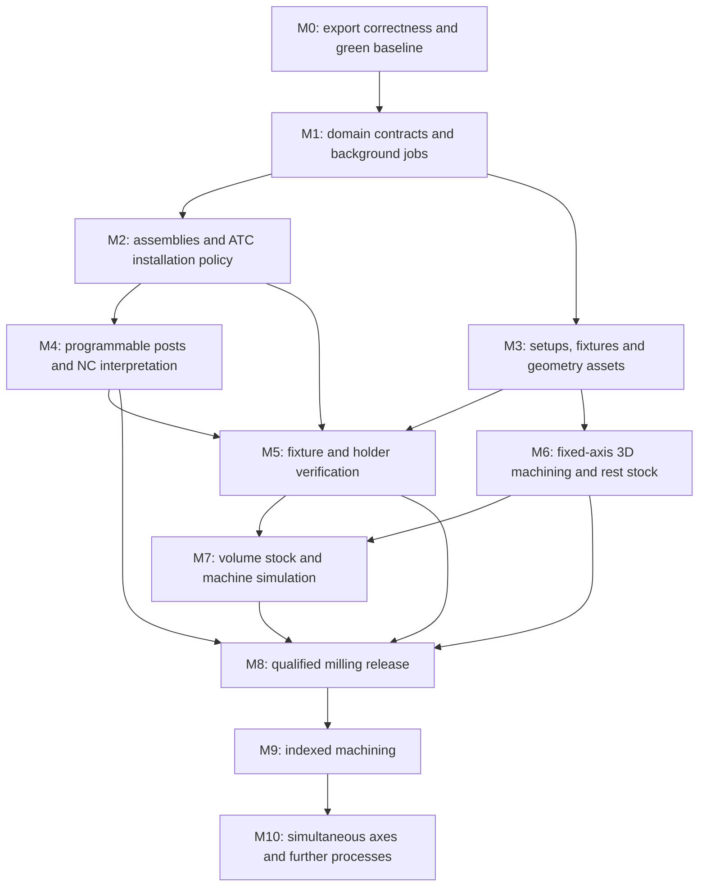

# Implementation plan: qualified milling and industrial CAM evolution

Date: **2026-10-13**. Baseline: [`5c510b504fe39f4e40700ff3b1e331d0309fcad3`](https://github.com/pr0m1th3as/OpenCAMStudio/tree/5c510b504fe39f4e40700ff3b1e331d0309fcad3). Read the [architecture assessment](architecture-analysis.md) and [validation evidence](architecture-validation.md) first. Everything described below is proposed work, except explicitly identified reusable components.

**Progress on the fork (2026-10-13):** the four clearing regressions have been diagnosed and fixed on `codex/fix-adaptive-clearing`; the headless suite reports 677 passed and no failures, and clippy passes with warnings denied. See the [fix report](adaptive-clearing-fix.md).

The next package on `codex/block-incomplete-job-export` addresses A01: explicit
job completion now propagates through planning, controller and GUI, and cancelled,
incomplete or failed runs cannot be exported. Validation: 688 passing headless
tests (23 ignored), 183 passing GUI-feature tests and both clippy configurations.
See [completion-aware export](job-completion-export.md). Continue with central IR
validation and full arc travel bounds, followed by drill-cycle verification.

## 1. Product scope and sequencing

Target the first qualified release at **fixed-axis three-axis milling**, including multi-tool/ATC jobs on configured installations, programmable posts, CAD/mesh surface machining, fixtures and holder collision checks, and independently checked exported NC. Start with a small declared controller/machine matrix. Do not claim every controller or arbitrary macro is supported.

The existing 2.5D workflow must continue to work during development. Preserve built-in strategies, integer planar geometry, headless tests, the neutral IR and existing post-family implementations. Use schema migrations and adapters instead of a new application rewrite.

Prioritize demonstrable end-to-end slices. Full 5-axis, turning and mill-turn follow separate gates. Native third-party plugins are deferred until the model is stable; user-programmable post definitions can be delivered earlier through a controlled runtime.

Milestone dependencies:



These are implementation milestones, not replacements for the repository's historical P0–P8 phases. Parallel development streams are possible after contracts stabilize; they share integration gates. Estimates should be made after M0 and the geometry/collision spikes, using measured team capacity and the actual qualification machine matrix.

## 2. Target module boundaries

Create a new crate when it establishes a real independently testable boundary, not for every type below. Initial module extractions can remain in existing crates.

| Boundary | Responsibility | Suggested placement |
|---|---|---|
| Domain project | IDs/revisions, geometry references, setups, operations, assemblies, stock definitions, manufacturing suppression | Evolve `cam-model`; split submodules first |
| Geometry assets and queries | Mesh assets/BVH, face/edge selection, cutter-contact queries; optional CAD handles behind an adapter | New `cam-geometry3d`; add `cam-kernel` only for actual CAD backend |
| Tooling | Cutter/holder/assembly definition, envelope generation, materials/cutting defaults | `cam-model::tooling` initially; library persistence adapter outside domain |
| Installation/kinematics | Machine definition, joint/link tree, limits, transforms, tool assignment and controller/post binding | New `cam-machine` when execution needs it |
| Planning and linking | Strategy dispatch, operation dependencies, tool-use scheduling, transition generation | Extract `cam-plan` from `cam-toolpath::plan` when M2 lands |
| Neutral program | Controller-independent cutter poses, curves and process intents with source IDs | Evolve `cam-cldata` in versioned steps |
| Canonical execution | Cycle expansion, state transitions, motion traversal, interpolation and bounded approximation | New `cam-motion`; no GUI dependency |
| Posting | Profile validation, post events/scripts, central writer, source mapping, lowered output | Evolve `cam-post`; keep compiled first-party emitters |
| NC interpretation | Supported-controller subset → independently reconstructed execution; unknown-state diagnostics | New `cam-nc` |
| Stock removal | Heightfield and volume-capable stock backends; residual/gouge comparison and stock snapshots | Evolve `cam-sim` |
| Collision verification | Swept assembly/fixture/machine-body checks, policies, distance/coverage reporting | New `cam-verify` when M5 lands |
| Rendering | Scene instances, meshes/LODs, playback presentation, picking/highlighting | Evolve `cam-render`; consume verification data |
| Application services | Job scheduler, document commands, file/config adapters, cache/invalidation, export gate | Modules/services beneath `cam-app`; GUI remains presentation |

Avoid a dependency cycle between the domain and post system: installation profiles can bind IDs/configuration in the composition layer; the domain should not serialize a Rust `PostKind` as the only possible future post identity. Keep CAD backend and GPU types out of strategy/domain/verification interfaces.

### 2.1 Essential data contracts

The names below are illustrative design sketches, not APIs promised to downstream consumers.

```text
Project
  schema_version, project_id, revision
  geometry_assets[]: stable asset ID + revision + source units + content hash
  cutter_definitions[], holder_definitions[], assembly_snapshots[]
  setups[]: SetupId, rigid transforms, WCS selection, stock, fixtures, operations
  manufacturing suppressions, operation dependencies, intended output targets
  provenance: authoring machine/post/config fingerprints

MachineInstallation
  MachineDefinition: joints, links, frames, limits, machine collision assets
  ControllerProfile: firmware/options, post ID/version/config, supported modes
  ToolAssignments: AssemblyId -> T number, H/D registers, pocket, measured offsets
  Placement: setup-to-machine transforms and initial state, or explicit unknown
  ToolChangePolicy: manual/ATC, approach sequence, pre/postconditions

JobRequest
  request_id, project_revision, immutable resolved inputs, cancellation, progress

JobResult
  completion: Complete | Cancelled | Failed
  per-operation artifacts, source-tagged program, diagnostics, input fingerprint

VerificationReport
  status: Pass | Fail | Incomplete | Unsupported
  coverage: bodies/motions/controller features checked + omissions
  accuracy: tolerances, stock resolution, conservative bounds
  events: source step/NC line, bodies, time interval, position, clearance
  fingerprints: project + installation + post + program + verification settings

ExportArtifact
  exact NC bytes + hash, source map, setup/tool sheets, report, provenance
```

Use named IDs rather than interchangeable integers for tool, assembly, setup, body and operation identities. Revisions and content hashes prevent stale results from silently reusing changed assets. Distinguish nominal modeled geometry from measured machine offsets; do not overwrite controller measurements with library defaults.

## 3. Milestones and acceptance criteria

### M0 — Establish a trustworthy export baseline

**Dependencies:** none. **Addresses:** A01–A07 in the assessment. **Files:** `cam-cldata`, `cam-post::{lib,dialect,writer,grbl}`, `cam-sim::lib`, `cam-toolpath::{plan,clearing}`, `cam-app::controller`.

Deliver small focused changes:

1. Preserve `Complete/Cancelled/Failed` at strategy aggregation and controller level; reject incomplete runs from both in-memory and file export. Clear/reject stale outcomes when inputs change.
2. Add an IR validator for finite coordinates/feeds/RPM, positive rates, valid tool/datum references, consistent arc start/end radii and planes, legal dwell/cycle parameters, and valid machine/options. Validation should be headless and return source-tagged diagnostics.
3. Compute full swept arc bounds, including quadrant extrema, helices and full circles; retain the current travel-span precheck but label it accurately.
4. Introduce a canonical cycle-expansion/traversal service. Simulate approach, drilling/pecks, retracts and links, retaining final position. Replace unknown-tool fallback with a diagnostic/error for verification. Resolve controller compensation effects where modeled; otherwise mark those motions unsupported rather than implying they were fully checked.
5. Fix Grbl M6 declaration/lowering and specify manual/ATC/TLO policy for each currently supported profile. Do not assume that every Grbl descendant shares tool-change behavior.
6. Centralize transition state sufficiently to ensure both operation-boundary and internal Carve changes meet defined pre/postconditions. Require tested spindle/coolant/offset semantics; macro assumptions must be profile data. Invalidate post-writer position after M6 unless the installation guarantees its return pose, and explicitly restore a verified approach before descent.
7. Investigate the four failing clearing tests. Compare supported toolchain/platform behavior, actual strategy dispatch, certification rejection reasons and fallback diagnostics. Fix the cause or update genuinely obsolete expectations with documented evidence; do not simply suppress tests.
8. Add regressions for the four reproduced probes and controller-policy findings. Update architecture/roadmap claims about actual modules, synchronous jobs, saved provenance and post count.

**Acceptance gate:** the complete supported headless test suite is green; all four documented counterexamples are rejected/detected as intended; Grbl NC is accepted by its declared supported parser/profile; two-tool LinuxCNC and one industrial profile explicitly satisfy offset/change policy. Existing representative 2.5D geometry remains unchanged except intentional documented NC corrections. Invalid/cancelled jobs cannot obtain a passing export artifact.

**Demo:** import a drawing, run a two-tool job with appropriate change policy, verify, export; cancel the same job and demonstrate that export is unavailable.

### M1 — Domain contracts, services and asynchronous jobs

**Dependencies:** M0. **Addresses:** A11, A14–A16; foundations for A09/A10/A12.

Extract controller services for document commands, geometry selection, job execution and export. Split GUI modules by coherent views and inspectors, reusing shared operation metadata to reduce repeated dispatch. Keep typed first-party operation parameters; a registry need not replace every exhaustive match immediately.

Introduce stable IDs/revisions and immutable asset handles. Define result completion and diagnostic codes, source references, cancellation and progress contracts. `Diagnostic.message` remains display text, not the only programmatic meaning. Use bounded/coalesced history and shared geometry assets; measure before replacing all snapshot history.

Move generation, verification and render preparation onto worker tasks. GUI submits an immutable `JobRequest`; edits increment revision and cancel superseded jobs. Accept a result only if request ID and input fingerprint still match. Add per-operation caching and explicit dependencies; any reordering, stock change, tool assembly change, setup transform, post policy or machine assignment must invalidate the appropriate artifacts.

**Acceptance gate:** a deliberately long job leaves UI interactions responsive; cancellation stops all involved services; an old job finishing after a new edit never replaces current geometry or enables export. Headless controller tests remain possible without a graphics stack. Undo/redo restores manufacturing state and invalidates exactly the affected results.

### M2 — Tool assemblies and installation-specific ATC

**Dependencies:** M1. **Addresses:** A06/A10, requested tool library + ATC.

Migrate `Tool.number` references to stable cutter/assembly references while retaining legacy import/export adapters. Separate library catalog definitions, immutable project snapshots and machine assignment. Existing geometry-based reconciliation can remain an explicit import-assistance operation; it must not establish physical assembly identity automatically.

Add holder/arbor/extension geometry, gauge-line and cutter-tip frames, stickout and measured assembly parameters. Support native parametric envelopes plus imported meshes with known units and validation. Add search/tags/catalog metadata and material-specific cutting data without turning machine pocket numbers into catalog identity.

Introduce fixed/random magazine assignment semantics, T/H/D register mapping, station capacity, missing/duplicate assignment validation, and preselection support where configured. Keep PLC/ATC handshake execution on the controller. Represent relevant change paths/envelopes and postconditions in the installation policy for verification.

Refactor compound operations to emit typed tool-use sections or requests that the scheduler expands into transitions. Keep strategy authority over cutting order; put machine-dependent change clearance, offsets and spindle/coolant sequencing in one service. Do not globally reorder by tool without honoring operation/stock/setup dependencies.

**Acceptance gate:** one cutter in two holders creates two distinct assemblies; renumbering/pocket reassignment does not change operation identity; absent assemblies and ambiguous offsets block export. Qualify manual, fixed-pocket ATC and random-pocket profiles as separate configurations. A clearing-tool → V-bit Carve job uses the same validated transition mechanism as adjacent single-tool operations.

**Demo:** a job reopens on another shop installation, reports provenance mismatch, binds assemblies to that installation and regenerates verified NC with its T/H/D/pocket mapping.

### M3 — Multiple setups, fixtures and geometry assets

**Dependencies:** M1; coordinate contracts shared with M2. **Addresses:** A09/A12/A13.

Migrate the single setup into a setup collection. Distinguish WCS selectors from setup transitions and physical re-fixturing. Add rigid part/setup/fixture/machine transforms, canonical units and typed frame references. Existing origins migrate without inventing orientation data: ambiguous historical reorientation semantics require an explicit assumption/diagnostic.

Add target part assets, mesh/primitive stock definitions, fixture/clamp bodies and per-setup enabled states. Persist manufacturing exclusions and setup choices; keep highlighting, viewport visibility and selection as presentation state. Preserve local machine selection versus authoring provenance; project placement/config requests must resolve against the local installation rather than silently installing foreign safety limits.

Implement mesh import with units, scale, normals, degeneracy/nonmanifold diagnostics, spatial indexing and selection. Add a geometry query interface that can later be backed by CAD surfaces. Run a bounded backend spike for STEP/B-rep import and tessellation; select a backend using fixture files and concrete failure reporting. Do not implement a general CAD editor first.

Create crash-safe saves: temporary file in the destination directory, validated serialization, platform-appropriate flush/rename and recovery handling. Surface critical project/library save failures. Store large immutable assets outside per-edit snapshots, either in a versioned package or content-addressed project assets; keep `.ocam` migration support.

**Acceptance gate:** a two-sided part has explicit orientation transforms and independently placed clamps; operations select the intended surfaces after reload. Units cannot silently change scale. Unknown datum/asset references fail validation. Interrupted save preserves either the previous complete project or the new complete one. Legacy projects reopen through tested migrations.

### M4 — Programmable posts and independent NC interpretation

**Dependencies:** M1/M2 and M3 frame semantics. **Addresses:** A05 and programmable G-code support.

Extend controller capabilities from booleans to structured constraints. Define post packages with stable IDs, versions, firmware/options, configuration schema, machine compatibility, unit/arc/feed modes and supported process intents. Keep compiled posts as known baselines and allow package selection without editing `PostKind` everywhere.

Start with declarative formats and typed hooks for program start/end, tool-section start/end, spindle/coolant, datum changes, motion and cycle handling. Then add constrained scripting for controller-specific logic. A Rhai-style runtime, WASM or isolated process are candidates to evaluate; choose based on bounded execution, portable packaging and the event contract. Scripts receive explicit context and owned data and should have no file/network access by default. Version scripts/configuration and bound instructions, memory and output size.

Keep central facilities for numeric formatting, modal state, unsupported-feature errors and source mapping. Typed macro events should declare known motion/state effects where possible. Arbitrary inserted NC with unknown effects must downgrade verification to incomplete/unsupported; it cannot inherit a full verification claim.

Add a supported-subset NC parser/interpreter independent of the emitter's implementation. Reconstruct modal states, WCS, units, offsets, arcs, cycles, stops, tool changes and configured macro effects. Compare intended execution to posted/reinterpreted execution within tolerance, and run collision verification against that output. Distinguish unsupported NC from invalid NC. General user-authored controller macro languages can be a later separate feature.

**Acceptance gate:** a user installs a post package and changes safe-start/number formatting without rebuilding Rust; unsupported intent errors identify the operation and package. Every supported baseline post has golden fixtures plus semantic interpretation. Rounding, offsets and cycle lowering remain within the allocated error budget. Changed post script/config invalidates prior NC verification.

**Demo:** identical neutral machining intent produces qualified output for two configured controllers; a deliberately broken script, unsupported macro and stale post version cannot yield a passing artifact.

### M5 — Fixture and holder collision verification

**Dependencies:** M2/M3/M4. **Addresses:** A03/A08; requested clamping/collision detection.

Use one canonical execution timeline for stock removal, collision checking and playback, while retaining an independent NC interpretation layer to detect post defects. Include tool-section changes, positioning, cycle motions and setup transition checkpoints. Initial poses and unknown machine/offset state must be explicit.

Implement a body/transform scene and collision policy matrix. Include cutter, flute/non-cutting neck/shank, holder, stock, target part and fixtures. Intended cutting contact with stock is permitted only for cutting surfaces and correct process states. Holder-stock, assembly-fixture and cutting into protected target material are forbidden. Known mounting/assembly contacts require explicit allowed pairs; do not disable all machine-machine contact by default.

Add broad-phase BVH/AABB filtering and conservative swept checks. Select analytic shapes, convex decompositions or triangle methods according to accuracy/performance measurements. Account for the whole segment/sweep so a collision between sampled endpoints is detected. Keep visual mesh LOD separate from verification proxies and document conservativeness.

Integrate target gouge and residual checks in the application. Report body IDs, source operation/segment/NC line, time interval, collision location, minimum clearance and checking tolerance. Add stop-on-first and collect-all modes, local replay and highlighted bodies.

**Acceptance gate:** detect a holder hitting a clamp while the cutter is clear, a shank rubbing remaining stock, a rapid crossing a thin fixture between endpoints, and a gouge into the target. Known-clear cuts remain clear within the reported error bound. Unresolved tool/fixture geometry yields incomplete verification, not a clean result. The UI displays actual coverage.

**Demo:** a clamp collision is traced to an NC line; moving the clamp changes the input fingerprint, invalidates the old report, and triggers re-verification.

### M6 — Fixed-axis three-dimensional machining and rest stock

**Dependencies:** M3; integrate with M5 before shipping. **Addresses:** requested 3D toolpaths and general stock-aware planning.

Implement accelerated triangle/surface queries and first deliver ball-nose raster finishing over a bounded accessible surface. Compute cutter center from contact geometry; trim paths to boundaries and collision/reach limits; calculate collision-safe links and entry/exit. Keep output as XYZ motions in the current IR where possible.

Add Z-level roughing, waterline finishing and constant-scallop/steep-and-shallow coverage in separate validated slices. Implement per-axis/wall/floor allowances, stock-aware links and rest machining from prior operation results. Treat in-process stock as an input/output artifact with an operation dependency graph, not just a display mesh regenerated at the end.

Define a single machining error budget allocating CAD tessellation, cutter contact approximation, arc/path fitting, NC rounding and verification error. Specify feed modes and permitted dynamic smoothing. No strategy may improve speed by silently exceeding the requested tolerance. Adapt refinement to geometry/tolerance rather than arbitrary fixed samples.

**Acceptance gate:** plane, ramp, sphere, filleted pocket, steep wall and saddle fixtures meet declared surface deviation/scallop bounds for supported cutters. Compare at least one oracle/reference geometry independently from the path generator. Rest machining removes material missed by a larger previous cutter without recutting the whole part. M5 verification detects deliberate collision/gouge injection in each new strategy family.

**Demo:** imported 3D part → roughing → large-tool finish → small-tool rest finish → holder/fixture verification → posted NC and setup sheet.

### M7 — Volume stock and full-machine simulation

**Dependencies:** M3/M5/M6; machine/controller integration from M4.

Keep the heightfield for supported fixed-axis preview/verification, but introduce a `StockBackend` abstraction with removal, occupancy/distance queries, target comparison, snapshot/restore and setup transformation. Prototype multi-direction dexel and sparse voxel/volume approaches using memory, accuracy and replay benchmarks. Choose a backend from evidence; no single resolution is adequate for all parts and all claims.

Implement a machine link/joint tree with axis homes/limits, reference frames, table/spindle geometry and assembly mount frames. Start with a Cartesian three-axis mill. Forward kinematics drive display and collision transforms; resolve setup placement into machine coordinates and validate joint limits over full trajectories. Add rotary-chain variants only after this works.

Model tool-change and fixture transition motions that affect checking; when the controller macro is unavailable, report the excluded motion and do not claim verified ATC clearance. Add collision pairs for machine/fixture, spindle/holder/fixture, machine self-collision and assembly/travel envelopes. Improve execution timing using rapid policy and axis speed/acceleration data; characterize jerk/dynamics separately if supported.

Add simulation playback, pause/scrub, stock checkpoints and deterministic replay. Store results keyed by exact execution/configuration fingerprints. Render machine CAD/meshes through scene instances; animated appearance must be driven by the same poses verified by the checker.

**Acceptance gate:** full-body three-axis machine playback detects a spindle-body/fixture collision and a placed WCS exceeding an absolute axis limit even though the path span fits. Stock survives a defined setup reorientation with reported approximation error. A collision during an explicitly modeled ATC path is detected. Unknown controller-motion segments appear as coverage gaps. Scrubbing reproduces the same stock and events.

### M8 — Qualified milling release and operational reliability

**Dependencies:** M4–M7 integration gates; M0 remains mandatory.

Pick explicit supported machine/controller/firmware/post configurations and maintain a qualification manifest for each. Gather manufacturer/control reference programs and validate emitted output in available controller interpreters/offline environments, followed by supervised dry-run and controlled cutting trials. Qualify each profile; do not generalize one Fanuc machine's acceptance to every Fanuc-like installation.

Deliver setup sheets containing stock, part/fixture/WCS diagrams, tool assemblies, T/H/D/pocket assignments, program revision and fingerprints. Add material/cutting calculators, realistic spindle power/torque/feed constraints, hole-making families, probing where explicitly supported and actionable diagnostics. Overrides need reason/provenance and must not pretend an unchecked condition passed.

Make export one transactional artifact: verify exact final NC bytes and their interpreted execution, include coverage/tolerance report and post/installation snapshots, then write those same bytes. Any geometry, clamp, tool, machine, post, offset, suppression or verification-setting change invalidates the report. Verification failed/incomplete/unsupported states have distinct handling and cannot automatically become a full pass.

Add autosave/recovery, portable issue bundles, memory/time budgets, crash reporting with opt-in data handling, release signing/reproducibility work where practical, and supported-platform GUI regression checks. Pin an actual tested Rust version for release qualification; `channel = "stable"` alone is a moving baseline. Keep a current-stable CI job as a separate compatibility signal.

**Acceptance gate:** a published declared milling capability matrix, passing regressions and machine/post qualification records; reproducible exported artifact and setup sheet; recovery preserves prior work; operator understands exactly which motions/bodies were verified. Performance targets use documented reference hardware, meshes, path sizes and tolerances.

### M9 — Indexed 3+2 machining

**Dependencies:** M8 and validated rotary machine variants from M7.

Add oriented tool poses and index transitions, rigid setup orientation, rotary forward/inverse kinematics, solution selection, axis limits, safe indexing and unwinding. Support controller workplane/TCP conventions as explicit profile capabilities. Preserve part-space cutter intent while representing machine-space execution separately.

**Acceptance gate:** tilted-face machining on supported table/head configurations matches intended geometry, verifies index/retract transitions and rotary limits, and survives nonzero tool length/pivot offsets. Different kinematic solutions are selected deterministically and reverified.

### M10 — Simultaneous axes, turning, mill-turn and extension API

**Dependencies:** M9; separate product/qualification decisions.

Simultaneous milling needs orientation interpolation, inverse kinematics along curves, singularity handling, collision-driven orientation, rotary velocity/acceleration constraints, TCP and inverse-time/feed semantics. Implement one defined machine topology/profile first.

Turning needs spindle synchronization, X diameter/radius semantics, CSS, tooling/turret and turning insert/holder geometry, cycles and process-specific stock/removal. Mill-turn adds spindle/channel synchronization, transfer/chucking states and competing machine resources. These do not fit the current flat milling operation/environment model without new contracts.

Only now freeze third-party strategy/post ABI after first-party contracts have been exercised. Choose explicitly between a versioned C ABI with owned buffers, a serialized subprocess protocol, or WASM components. Define capability negotiation, cancellation/progress, allocator ownership, package compatibility and crash containment. Preserve static first-party and headless operation.

**Acceptance gate:** process-specific correctness and qualification suites, explicit supported machine topology, bounded failure behavior and version compatibility tests; plugin failure cannot corrupt the active document or silently produce unchecked NC.

## 4. Cross-cutting verification program

| Area | Required evidence |
|---|---|
| Geometry | Degenerate/self-intersecting/near-tangent fixtures; large/small coordinates; unit conversion; transform invariance; fuzzing for crashes/resource exhaustion |
| Toolpaths | Complete coverage, target deviation, engagement/allowance bounds, correct entry/link ordering and stock dependencies; independent oracles where practical |
| Motion execution | Arc extrema/full circles/helices, cycle expansion, tool/datum changes, first-motion assumptions, unknown state, cancellation and resumability |
| Posts | Golden output plus independent semantics; modal reset/offset behavior; supported parser/control acceptance; unsupported features refused |
| Collision | Intended/forbidden contact matrix, whole swept motion, thin obstacles, holder/shank/fixture cases, false-negative characterization and conservative bounds |
| Persistence | Historical migration fixtures, future-version refusal, asset hashes, damaged/partial files, atomic-save fault injection and manufacturing suppression round-trip |
| Application | Responsive workers, stale-result rejection, memory bounds, deterministic replay, source-linked diagnostics and exact-artifact export |
| Release | Locked dependencies/toolchain, supported-platform checks, documented qualification matrix, reproducible reports and change impact reviews |

Existing golden NC should be updated only after the semantic behavior change is explained and checked. A passing golden comparison cannot establish controller acceptance by itself. The independent interpreter should not call the emitter's own lowering functions for its expected behavior, or it will reproduce the same defect.

## 5. Initial issue-sized backlog

These are suitable first changes after agreeing on target scope; each should carry its own acceptance test and source-linked description.

| Order / issue | Deliverable | Blocks |
|---|---|---|
| 1. Diagnose clearing regressions | Reproducible toolchain/platform baseline; four failures resolved with documented cause | All later release claims |
| 2. Reject incomplete jobs | Completion propagated through planner/controller/export; cancellation regression | Background jobs, export assurance |
| 3. Validate IR and bounds | Finite/positive parameters, arc consistency/extrema, explicit invalid references | Reliable machine checks/posts |
| 4. Canonical drill execution | Shared supported cycle traversal, final position preserved, unknown-tool failure | Credible stock verification |
| 5. Correct controller policies | Grbl M6 and length-offset behavior; explicit two-tool change state | ATC qualification |
| 6. Document actual architecture | Nine-crate inventory; correct machine provenance and synchronous-run status | Contributor understanding |
| 7. Worker request/result service | Immutable revision-stamped jobs, progress and stale-result rejection | Large paths/3D/simulation |
| 8. Tool/assembly identity ADR + migration | Stable IDs, project snapshots, T/H/D/pocket mapping design and legacy adapter | ATC/holder collision |
| 9. Setup/frame ADR + migration | Multiple setups, physical transition vs datum select, placement semantics | Fixtures, real machine checks |
| 10. Tolerance/coverage contract | Explicit approximation budget and verification statuses | Surface paths, credible collision claims |
| 11. Geometry and collision spikes | Reference meshes, query backend benchmark, swept holder/clamp prototype | M3/M5/M6 scope estimates |
| 12. Programmable post contract | Typed events, package metadata, central writer, source-map/interpretation spike | User-defined posts |

Write short architecture decision records for tool identity, frames/setup transitions, stock representation, geometry query API, post runtime, verification/export provenance and extension protocol. Each should record alternatives, compatibility/migration impact and a testable decision, not just an aspirational diagram.

## 6. Delivery risks and scope controls

- **Geometry correctness:** prototype with difficult real parts before choosing a CAD backend. Mesh import/tessellation does not itself solve cutter contact or safe linking.
- **Controller diversity:** ship a small qualified matrix and add profiles individually. Require explicit macro/offset assumptions rather than generic family-level optimism.
- **Verification cost:** measure error/memory/runtime tradeoffs on named datasets; separate preview speed from verification accuracy. Detect budget exhaustion as incomplete.
- **Domain migration:** introduce stable IDs and transforms with fixtures and migration tests before implementing feature-specific UI around the old model.
- **Duplicated semantics:** reuse canonical intent execution for planning/simulation/playback, but keep NC interpretation independent to catch lowering defects.
- **Scope expansion:** complete and qualify fixed-axis milling before simultaneous axes or other processes. Programmable posts and ATC can deliver value well before an unrestricted plugin ecosystem.

Completion is defined by the milestone acceptance gates and the declared qualified capability matrix. “It renders,” “the NC looks plausible,” or “there is a trait for it” are not sufficient completion criteria for the requested industrial functionality.
